# OnyxBot

**English** · [Polski](README.pl.md)

**A Polish chat bot for Kick that turns viewers into players.** It puts games, points for watching, alerts, widgets and a streamer panel into one bot, and all of it is in Polish.

[Website](https://onyxbot.live) · [Discord](https://discord.gg/ss7j3EvKMQ) · Status: beta

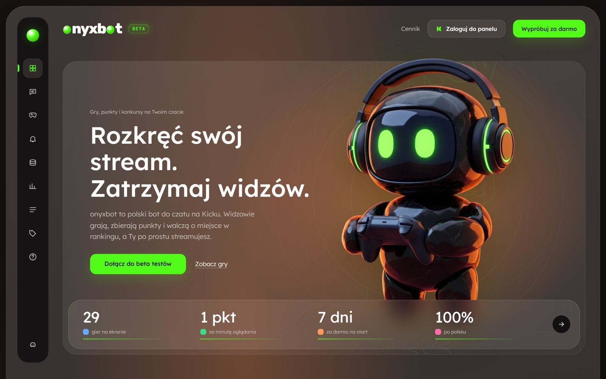

> The source code is private and this repository is a product showcase. The screenshots and GIFs show the real bot in demo mode, with test data.

## Contents

1. [At a glance](#at-a-glance)
2. [Games on stream](#games-on-stream)
3. [Widgets](#widgets)
4. [Alerts](#alerts)
5. [Points and rewards](#points-and-rewards)
6. [Streamer panel](#streamer-panel)
7. [Moderation](#moderation)
8. [Discord](#discord)
9. [Commands](#commands)
10. [Getting started](#getting-started)
11. [FAQ](#faq)

## At a glance

| 29 | 22 | 12 | 12 |
|:---:|:---:|:---:|:---:|
| games on stream | game themes | widgets | alert styles |

- **Nothing to install.** The bot runs on a server. Games, alerts and widgets go into OBS as browser sources.
- **Nothing for viewers to set up.** Viewers take part by typing in chat. They don't need an extra account or app.
- **One panel for everything.** The streamer logs in with their Kick account and switches every feature on or off, or fine-tunes it.
- **Runs without the streamer.** Moderators can start games, bets and contests themselves.
- **Fully Polish.** The bot, the panel and every widget are in Polish.

## Games on stream

One command and the whole chat plays. All games run in a single OBS browser source (1920×1080), so the streamer adds one link and gets all 29.

**How a round works**

1. The streamer or a moderator types the game command, for example `!wyscig`.
2. Viewers join with `!gram` and appear on screen right away.
3. The round plays out on stream. In some games chat takes part live, for example with `!boost` in the rally or with guesses in the safe.
4. The bot pays out points and announces the podium in chat.

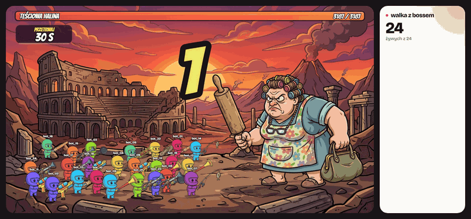

<table>
<tr><td>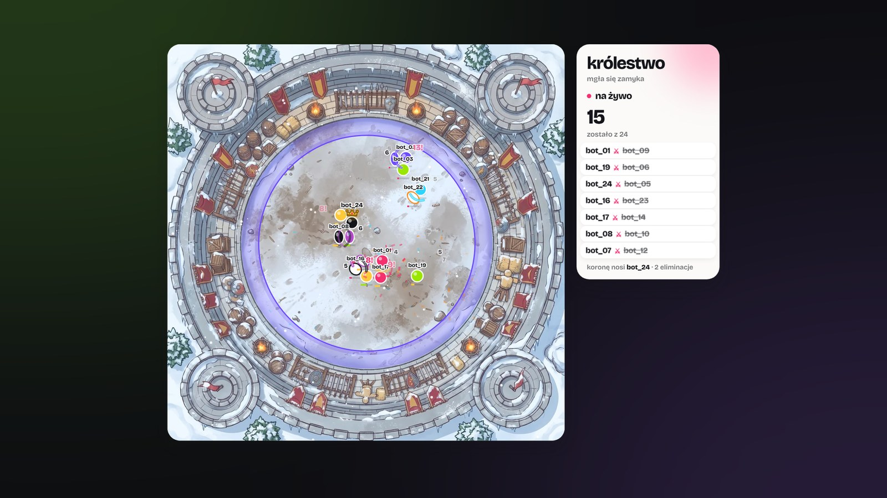 <b>Kingdom</b></td><td>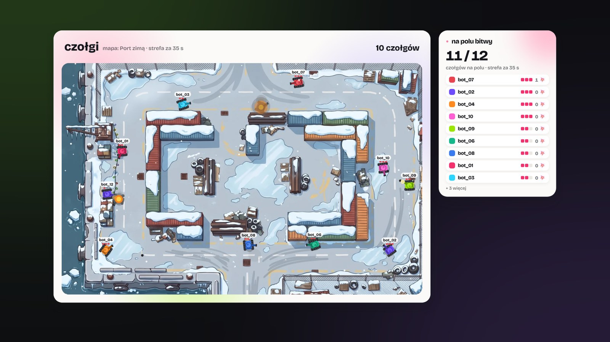 <b>Tanks</b></td></tr>
<tr><td>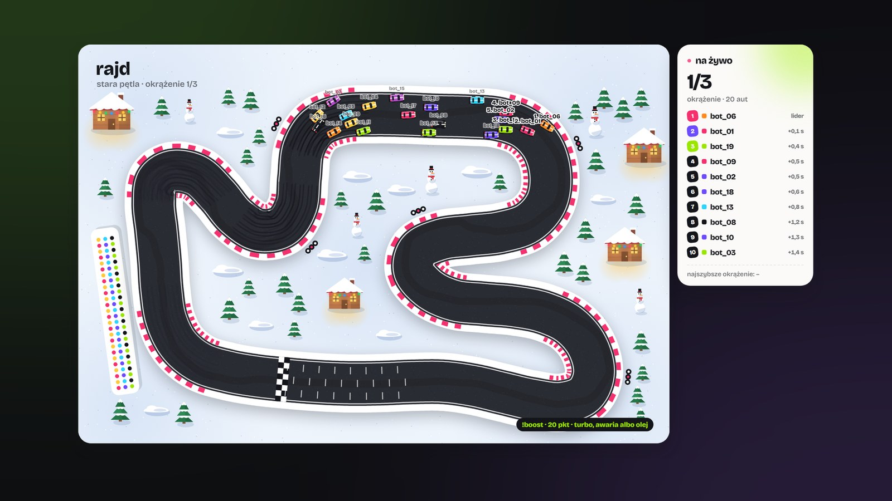 <b>Rally</b></td><td>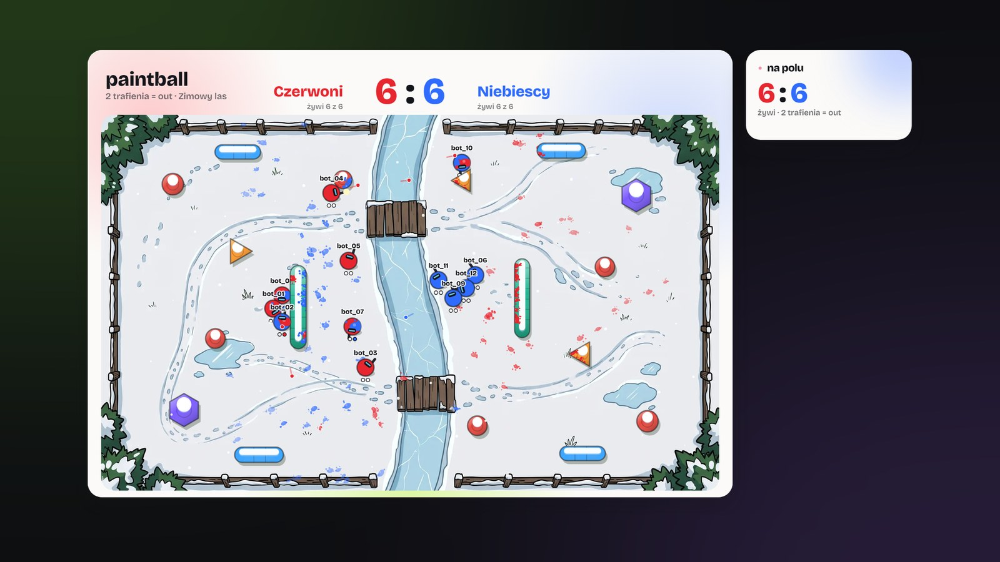 <b>Paintball</b></td></tr>
<tr><td>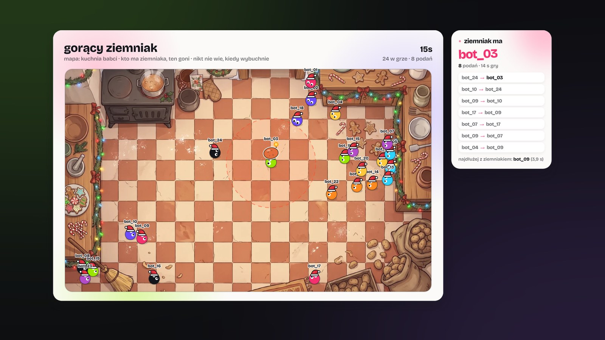 <b>Hot Potato</b></td><td>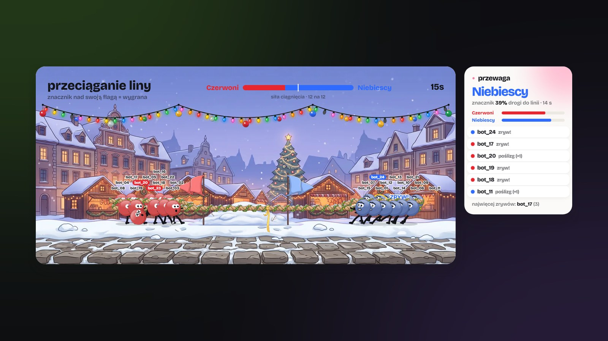 <b>Tug of War</b></td></tr>
</table>

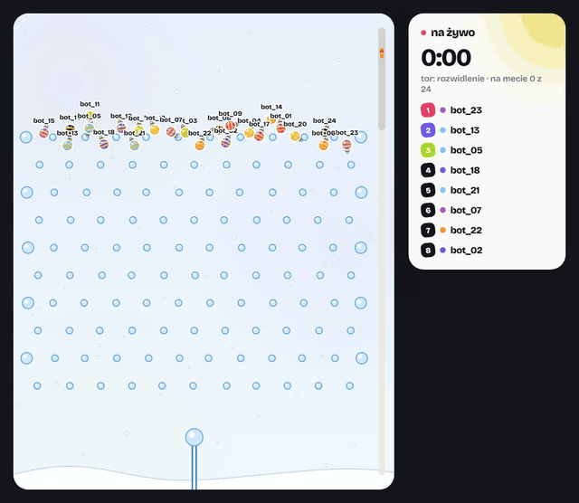

<b>Marble race</b> (<code>!wyscig</code>): everyone who typed <code>!gram</code> gets a marble, and the first one across the finish line wins.

### All 29 games

Rewards are the default amounts in points. Most of them can be changed in the panel.

**Races and battles.** Viewers sign up with `!gram`, then watch their character on screen.

| Game | Command | How it plays | Rewards |
|---|---|---|---|
| Marble race | `!wyscig` | Viewers' marbles roll down a random track. | 100 / 50 / 25 |
| Kingdom | `!krolestwo` | A marble battle royale in a shrinking zone. | 150 / 60 / 30, +10 per elimination |
| Rally | `!rajd` | Toy cars race three laps on one of five tracks. Drivers can type `!boost` (20 pts) and get a turbo, an engine failure or an oil spill. | 120 / 60 / 30 |
| Obstacle run | `!bieg` | Hammers, beams, pistons and gates on 6 maps, with a random map each run. | 120 / 60 / 30 |
| Sumo | `!sumo` | Players push each other out of a shrinking ring. | 150 / 60 / 30, +10 per elimination |
| The floor is lava | `!lawa` | Tiles go out one by one under the marbles. | 150 / 60 / 30, +10 per burnt tile |
| Red light, green light | `!swiatlo` | Players run on green and stand still on red. | 140 / 60 / 30 |
| Boss fight | `!boss` | Everyone gets an absurd weapon and fights a dragon, a zombie or a mother-in-law. Whoever lasts 30 seconds wins. | 120 / 60 / 30, +40 for surviving |
| Tanks | `!czolgi` | A free-for-all on 4 maps. Tanks drive and shoot on their own, three hits destroy a tank and the zone keeps closing in. | 150 / 60 / 30, +10 per kill |
| Meteors | `!meteory` | Meteors fall on an island in space while its edges crumble. The last one standing wins. | 200 |
| Zombie | `!zombie` | Patient zero infects others by touch in a town at night, and vaccines give 6 s of immunity. Players who are still human after 35 seconds win. | Humans 100, infected 15, zombies +10 per bite |
| Ducks | `!kaczki` | Players grab a duck and hold it to collect seconds, on one of 4 maps. The first to reach 30 s wins. | 150 down to 10, last place −50 |
| Musical chairs | `!krzesla` | When the music stops, anyone left without a chair is out. | 150 / 60 / 30 |
| Parachute | `!spadochron` | Everyone jumps over an island with a target, and the wind carries each player differently. | Bullseye +500, rings +200 / +100, water −200 |
| Ski jumping | `!skoki` | Each player gets one jump, and form and wind decide the distance. | 150 / 60 / 30, +100 for a hill record |
| Sledding | `!sanki` | A winding run down from the summit, with rocks, snowmen, jumps and ice. | 150 / 60 / 30 |
| Santa's presents | `!mikolaj` | Players race to the parcels Santa throws from his sack. A parcel can hold a console worth +300 or a birch rod worth −100. | Sum of opened parcels |
| Hot potato | `!ziemniak` | A potato with a fuse passes from hand to hand until it explodes. | Holder −150, blast radius −50, everyone else +50 |

**Team games.** The bot splits the players who signed up into two random teams.

| Game | Command | How it plays | Rewards |
|---|---|---|---|
| Volleyball | `!siatkowka` | Beach volleyball, played to 3 points. | Winners 50, losers 10, +10 per point |
| Paintball | `!paintball` | Reds against Blues on a field with a river and cover. Two hits put a player out. | Winners 50, losers 10, +10 per elimination |
| Snowball fight | `!sniezki` | The teams run between cover that breaks under hits, on 4 maps. Once per battle Santa's sleigh drops a present that boosts whoever catches it. | Winners 50, losers 10, +10 per player knocked out |
| Tug of war | `!lina` | The teams pull a rope over the mud. | Winners +100, losers −50 and a mud bath |

**Chat puzzles.** The whole chat guesses together, with one guess per person every 5 seconds.

| Game | Command | How it plays | Rewards |
|---|---|---|---|
| Safe | `!sejf` | Chat cracks a 4-digit code with Wordle-style hints. The vault starts at 100 and grows with every guess, and the alarm goes off after 3 minutes. | The whole vault, +10 for other guessers |
| Password | `!haslo` | Wordle in chat with a 4-letter Polish word. | Pool of 250, minus 5% per wrong guess |

**Games with points at stake.** Viewers bet their own points.

| Game | Command | How it plays | Payout |
|---|---|---|---|
| Roulette | `!ruletka` | Viewers have 30 s to bet with `!bet <colour> <amount>`, then the wheel spins on screen. | By colour |
| Horse race | `!konie` | Viewers have 45 s to bet on one of 4 horses, and each horse has a 25% chance. | ×3.5 |
| Doors | `!drzwi` | Four stages with 2, 3, 4 and 5 doors, and only one door leads on. Players can cash out between stages with `!stoj`. | ×1.6 / ×4.8 / ×19 / ×95 |
| Chest auction | `!licytacja` | One of three chests is drawn. Whoever holds the top bid for 10 s pays it and opens the chest. | Chest contents |
| Russian roulette | `!rosyjskaruletka` | Players pay an entry fee and the revolver goes around. | The pot, split between survivors |

Moderators can also draw a random game (`!gra`), skip the sign-up wait or cancel a game. When a game is cancelled, bets and entry fees go back to the players. Any game can be switched off in the panel.

### 22 themes

The theme is picked in the panel, and games already in OBS change their look immediately.

- **7 colour themes** change only the accents (labels, bars and badges): Onyx, Kick, Ocean, Violet, Candy, Gold and Graphite.
- **13 full themes** restyle the cards, backgrounds and decorations: Space, Winter, Hot Pink, Glamour, Green Mist, Pumpkin Patch, Spooky Night, Carbon, Matcha, Neapolitan, Royal, Lagoon and Cherry.
- **2 transparent themes** let the stream show through: Glass (semi-transparent dark cards) and No background (text and boards only).

## Widgets

Every widget has its own OBS link and a preview in the panel, and most come in several looks.

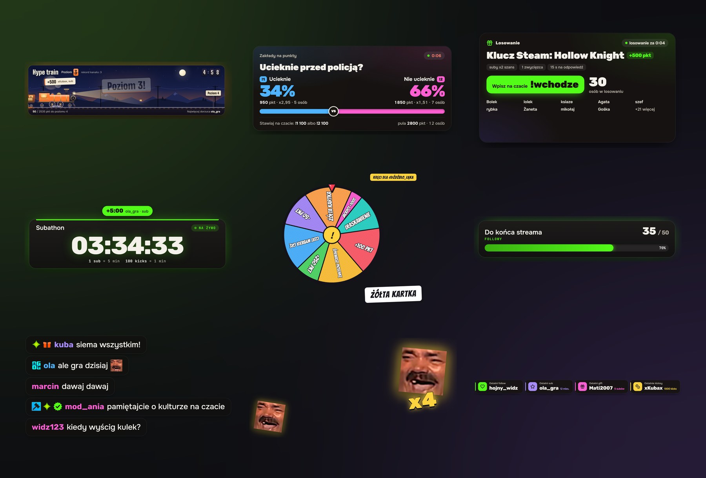

| Widget | What it does | Looks |
|---|---|---|
| Chat on screen | Shows messages with badges and emotes. | 8: Cards, Text only, Bubbles, Panel, Broadcast, Line, Phone, Pixel |
| Flying emotes | Floats 7TV emotes across the screen. Several identical emotes make a combo. | |
| Chat characters | Gives everyone who writes in chat their own little character. | |
| Goal bar | Counts follows, subs, Kicks or messages and shows how much is left. | 11 |
| Subathon | Adds time to the timer for every sub, gift and Kicks. | 6 colours |
| Hype train | Speeds up a train with a streak of subs and Kicks, level by level. | 6 colours |
| Latest supporters | Shows the latest follow, sub, gift and Kicks. | 4 |
| Viewer counter | Shows how many people are watching now and the stream's peak. | 3 |
| Polls and bets | Lets viewers bet points on the outcome with `!ankieta`. | |
| Wheel of fortune | Runs up to 5 wheels with weighted fields, each with its own command. The wheel can add or take points from a viewer (`!kolo`). | |
| Giveaway | Draws the winner on screen. | 3 animations: Crate, Drum, Letter shuffle |
| Text to speech | Reads chat messages aloud (`!tts`), with a points cost, a cooldown and filters. | |

Viewers can also buy sounds with points. The sound plays on stream without anything appearing on screen.

## Alerts

Follows, subs, gifted subs, raids and Kicks each have their own alert. The style is changed with one click, and the preview in the panel updates right away.

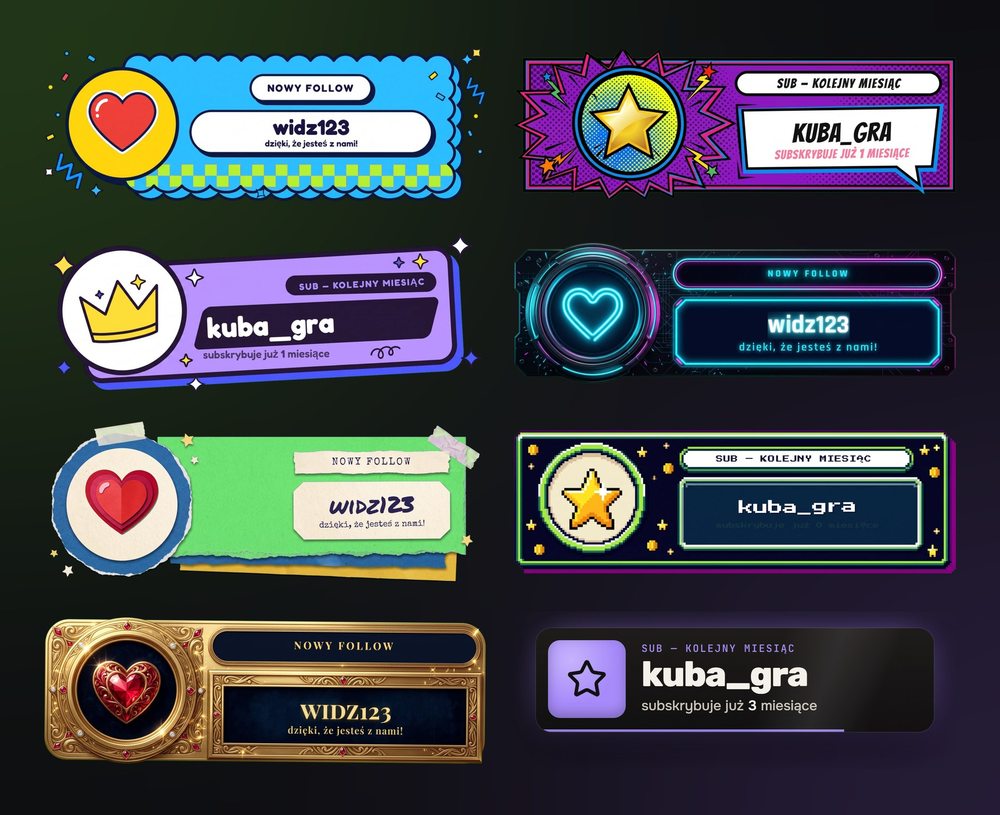

**12 styles:** Classic, Sticker, Dopamine, Cut-out, Pixel 8-bit, Neon, Comic, Gold, Minimal, Light, Line and Card (a collectible card with the viewer's avatar, rarity and stats).

Each type of alert can have:

- its own style and sound,
- its own GIF from Giphy, placed above the text, beside it or behind it,
- its own text with the viewer's nick,
- a frame in one colour or a gradient.

## Points and rewards

Points are the channel's own currency. They can't be bought or cashed out, and every channel keeps its own balances.

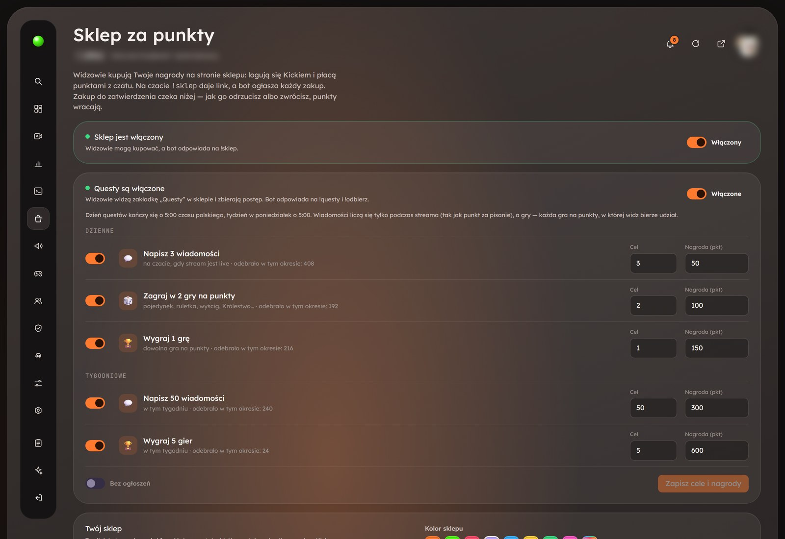

**Earning**

- **Watching:** 1 point per minute and 2 for subs (both adjustable). Kick doesn't share its viewer list, so the bot counts as watching anyone who is active in chat during the live. A pause in chatting counts for up to 10 minutes.
- **Chatting:** a point for each message during the live. Commands don't count, and one person can earn this at most once every 5 seconds, so spamming doesn't pay.
- **Games:** prizes from the [games](#all-29-games) on stream.
- **Chat race:** every now and then the bot posts a word or a quick sum, and the first correct answer wins 50 points.
- **Quests:** daily and weekly tasks, such as writing messages, playing games and winning them. `!questy` shows progress and `!odbierz` claims the reward. Days reset at 5:00 Polish time and weeks on Monday at 5:00.
- **Achievements:** 17 built-in achievements with bronze, silver and gold tiers worth +100 / +500 / +2000 points. Streamers can add up to 50 of their own. `!odznaki` shows the badges a viewer has earned.

**Spending**

- **Reward shop:** `!sklep` posts a link to the channel's shop page. Viewers log in with Kick and spend points on rewards set by the streamer. Purchases that need approval wait in the panel, and rejected ones are refunded.
- **Duels:** `!duel @nick <amount>`. The other viewer has 60 s to accept. `!matma` turns it into a mental maths duel.
- **Blackjack:** `!bj <amount>` against a dealer in chat, with `!hit`, `!stand` and `!double`. A win pays ×2 and a blackjack ×2.5.
- **Bets:** a moderator opens a bet with 2 to 5 options and viewers stake points (`!1 100`, `!2 all`). Winners get their stake back plus a share of the losing pool in proportion to what they put in.
- **Games with stakes:** roulette, horse race, doors, chest auction and Russian roulette.

## Streamer panel

The streamer logs in with their Kick account and gets the whole channel in one place: how the stream went, who was most active, and the settings for every feature.

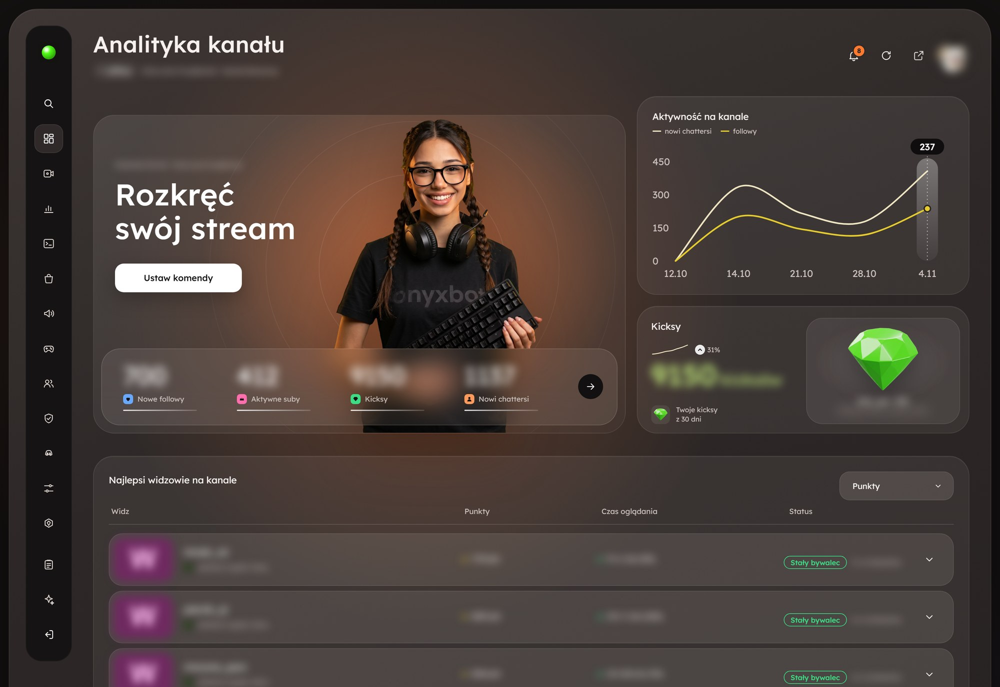

<table>
<tr><td>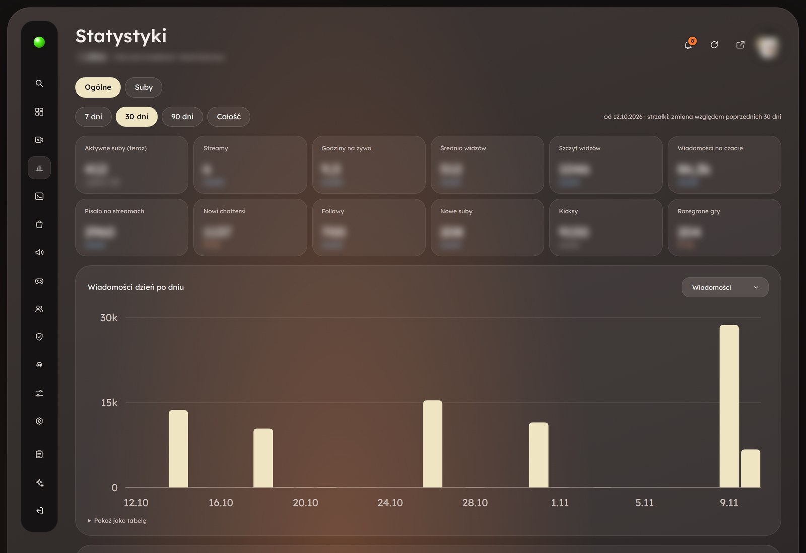 <b>Statistics</b></td><td>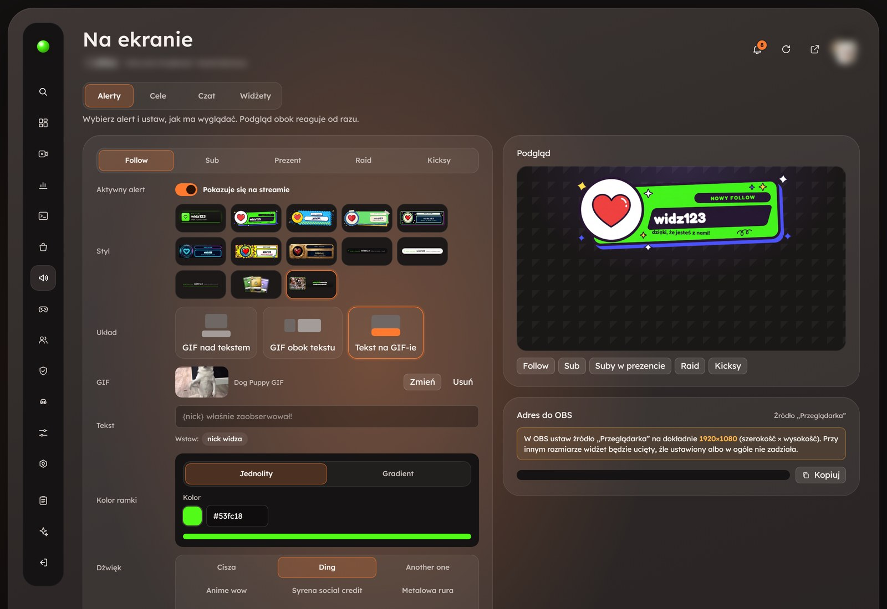 <b>Alerts and widgets</b></td></tr>
<tr><td>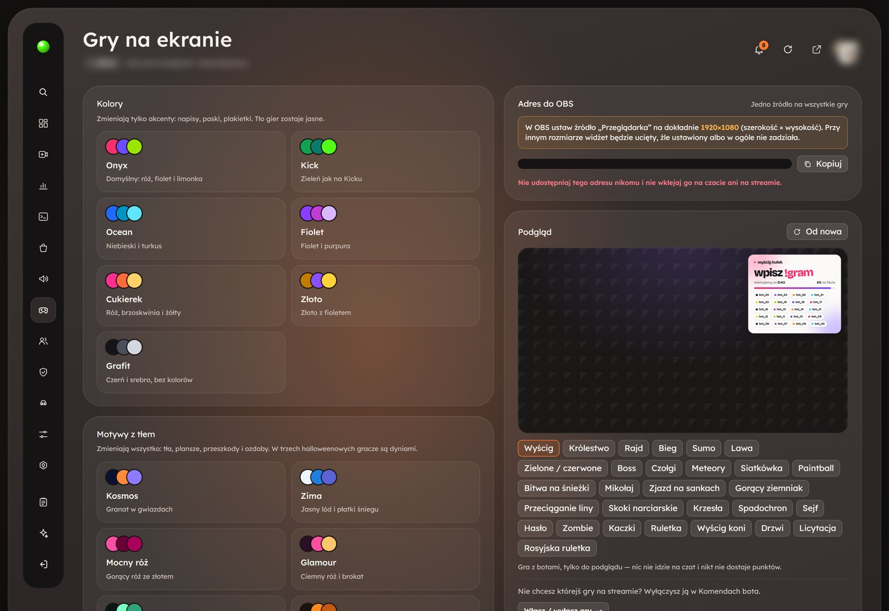 <b>Games and themes</b></td><td>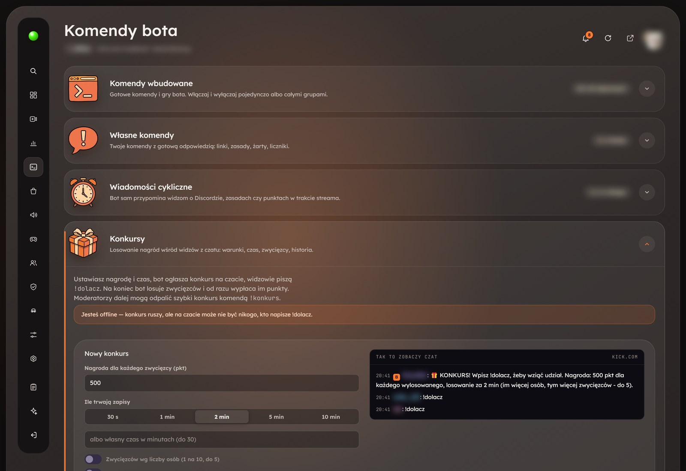 <b>Commands and contests</b></td></tr>
</table>

Channel data in the panel screenshots is blurred.

| Section | What's inside |
|---|---|
| Overview | The last 30 days at a glance: new follows, active subs, Kicks, new chatters, a channel activity chart and the top viewers. |
| Statistics | 12 indicators for 7 days, 30 days, 90 days or all time, compared with the previous period, plus a daily chart. The indicators are active subs, streams, hours live, average and peak viewers, chat messages, chatters, new chatters, follows, new subs, Kicks and games played. |
| Stream history | Every stream saved with its duration, peak and average viewers, messages, chatters, new follows, subs and Kicks. |
| Viewers | A points account for everyone who has chatted, sortable by points, messages or last activity, with manual point changes. |
| Bot commands | Every built-in command can be switched on or off, limited to subs or given a cooldown. Custom commands, timed messages and contests also live here. |
| On screen | Alerts, goals, chat and widgets, each with a live preview and an OBS link with the exact source size. |
| Games on screen | Themes, a preview, switching games on and off, and prize amounts. |
| Points shop | Rewards, purchase approval, quests and their goals. |
| Points and games | How many points come in, and for what. |
| Moderation, Achievements, Discord | Described below and above. |
| What's new | A changelog of every update to the bot, newest first. |

## Moderation

Automod is off by default and every protection is switched on separately. The bot never checks the streamer or their moderators.

- **Chat protections:** CAPS, too many emotes, links (with allowed sites) and too many symbols. Kick and 7TV emotes, links and @mentions don't count towards CAPS or symbols.
- **Banned words:** up to 500 entries, either as a fragment, which also catches other forms of the word, or as an exact whole word. Changing letter case, dropping Polish characters, swapping in digits (`sp4m`), stretching (`spaaam`) or adding dots and spaces (`s.p.a.m`) doesn't get past the filter. A ready-made list of Polish profanity can be added with one click.
- **Penalty for repeat offenders:** none, timeout or ban.
- **Exceptions:** words the filter never touches.
- **Message tester:** type what a viewer might write and see the result without posting it in chat.
- **Log** of deleted messages.

## Discord

One Discord server can be connected to a channel.

- **Live notifications:** when the stream starts, the bot posts the message the streamer designed, with the stream's title, category and link, a chosen ping and colour, and a "Watch on Kick" button.
- **Sub role:** a viewer links their Kick account with `!polacz KOD` and gets the sub role automatically. The role is removed when the sub expires.
- **Other channels:** the bot can also announce streams of other Kick streamers, such as friends' channels, even if they don't use OnyxBot.
- **Custom commands:** slash commands with the streamer's own replies, for example `/regulamin`.

## Commands

**For viewers**

| Command | What it does |
|---|---|
| `!gram` | Joins the game on screen during sign-up. |
| `!punkty [@nick]` | Shows points and ranking position for the viewer or for someone else. |
| `!top` | Lists the five viewers with the most points. |
| `!komendy` | Lists the commands enabled on the channel. |
| `!sklep` | Posts a link to the reward shop. |
| `!questy` / `!odbierz` | Shows quest progress / claims finished quests. |
| `!odznaki` / `!odznaka <name>` | Shows earned badges / explains an achievement. |
| `!duel @nick <amount>` / `!matma @nick <amount>` | Starts a duel / a maths duel for points. |
| `!akceptuj` / `!odrzuc` | Accepts / declines a duel. |
| `!bj <amount>`, `!hit`, `!stand`, `!double` | Plays blackjack against the dealer. |
| `!tts <message>` | Has a message read aloud on stream. |
| `!polacz KOD` | Links the Kick account to Discord. |

**For the streamer and moderators**

| Command | What it does |
|---|---|
| `!wyscig`, `!boss`, `!czolgi` and others | Opens a game on screen (all 29 listed [above](#all-29-games)). |
| `!gra` | Draws a random game from the enabled ones. |
| `!ankieta` | Opens a poll with bets: `!ankieta 120 Ucieknie? / Tak / Nie`, then `!ankieta wygrywa 1`. |
| `!konkurs <prize> [seconds]` | Starts a contest. Viewers join with `!dolacz` and the bot draws the winners. |
| `!kolo`, `!kolo @nick`, `!kolo losuj` | Spins the wheel of fortune, for a viewer or for a random chatter. |
| `!dajpunkty @nick <amount>` / `!zabierzpunkty` | Gives or takes points manually. |
| `!resetpunkty` | Resets every viewer's points to zero. Only the streamer can use it, and it needs two confirmations. |

## Getting started

1. **Get in touch** on [Discord](https://discord.gg/ss7j3EvKMQ) with your Kick name, and the bot gets added to your channel.
2. **Add the links to OBS:** one browser source for games and separate ones for alerts and widgets. The links and exact sizes are in the panel.
3. **Type `!wyscig`.** Chat joins with `!gram` and the bot does the rest.

## FAQ

**Do I need to install anything?**
No. The bot runs on a server, and games and alerts go into OBS as a browser source.

**Do viewers need to log in anywhere?**
No. It's enough that they write in chat on your channel. Only the reward shop asks them to log in with Kick.

**Are points worth money?**
No. They are your channel's currency. They can't be bought or cashed out.

**What happens to viewers' data?**
The bot stores the nick, points and watch time on your channel, and OnyxBot signs a data processing agreement with the streamer.

## Contact

[kontakt@onyxbot.live](mailto:kontakt@onyxbot.live) · [Discord](https://discord.gg/ss7j3EvKMQ) · [onyxbot.live](https://onyxbot.live)
