# OnyxBot

[English](README.md) · **Polski**

**Polski bot do czatu na Kicku i Twitchu, który zamienia widzów w graczy.** Gry na ekranie, punkty za oglądanie, alerty, widżety i panel streamera w jednym bocie, w całości po polsku.

[Strona](https://onyxbot.live) · [Discord](https://discord.gg/ss7j3EvKMQ) · Status: beta

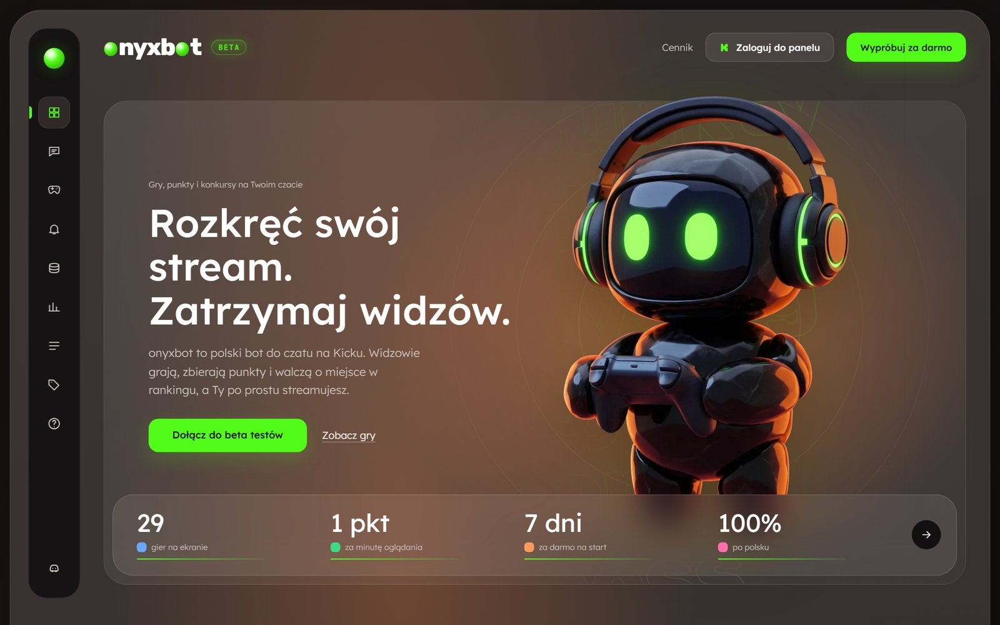

> Kod źródłowy jest prywatny, a to repozytorium jest wizytówką produktu. Zrzuty i GIF-y pokazują prawdziwego bota w trybie pokazowym, na danych testowych.

## Spis treści

1. [W skrócie](#w-skrócie)
2. [Kick i Twitch](#kick-i-twitch)
3. [Gry na ekranie](#gry-na-ekranie)
4. [Widżety](#widżety)
5. [Alerty](#alerty)
6. [Punkty i nagrody](#punkty-i-nagrody)
7. [Panel streamera](#panel-streamera)
8. [Moderacja](#moderacja)
9. [Discord](#discord)
10. [Komendy](#komendy)
11. [Start w trzech krokach](#start-w-trzech-krokach)
12. [Pytania](#pytania)

## W skrócie

| 29 | 22 | 12 | 12 |
|:---:|:---:|:---:|:---:|
| gier na ekranie | motywy gier | widżetów | wyglądów alertów |

- **Nic nie instalujesz.** Bot działa na serwerze, a gry, alerty i widżety dodajesz do OBS jako źródła przeglądarki.
- **Widzowie niczego nie ustawiają.** Grają, pisząc na czacie, bez zakładania kont i instalowania aplikacji.
- **Jeden panel do wszystkiego.** Logujesz się kontem z Kicka albo Twitcha i każdą funkcję włączasz, wyłączasz albo dopasowujesz.
- **Działa też bez Ciebie.** Moderatorzy sami odpalają gry, zakłady i konkursy.
- **W całości po polsku.** Bot, panel i wszystkie widżety.

## Kick i Twitch

Od listopada 2026 OnyxBot działa też na Twitchu. To ten sam bot z tym samym panelem, grami, widżetami, alertami, punktami i moderacją. Różnią się tylko rzeczy typowe dla platformy.

| | Kick | Twitch |
|---|---|---|
| Logowanie do panelu | konto z Kicka | konto z Twitcha |
| Alerty | follow, sub, sub w prezencie, raid, kicksy | follow, sub, resub, sub w prezencie, raid, bitsy |
| Wsparcie widzów w widżetach | kicksy | bitsy |
| Emotki w grach i widżetach | Kick i 7TV | Twitch i 7TV |
| Logowanie do sklepu | Kick | Twitch |

- **Czat na żywo w grach i widżetach.** Wiadomości i emotki z Twitcha od razu pojawiają się na ekranie. Usunięte wiadomości i timeouty znikają też z widżetu czatu.
- **Moderacja przez Twitcha.** Automod usuwa wiadomości, daje timeouty i bany narzędziami Twitcha. Bot musi mieć moda na kanale.
- **Statystyki z Twitcha.** Liczba widzów, followy, suby i historia streamów biorą się prosto z Twitcha.
- **Klipy.** `!klip` robi klip na Twitchu.

## Gry na ekranie

Jedna komenda i gra cały czat. Wszystkie gry działają w jednym źródle przeglądarki w OBS (1920×1080), więc dodajesz jeden link i masz od razu 29 gier.

**Jak wygląda runda**

1. Ty albo moderator wpisujecie komendę gry, na przykład `!wyscig`.
2. Widzowie zapisują się przez `!gram` i od razu pojawiają się na ekranie.
3. Runda toczy się na streamie. W części gier czat bierze udział na żywo, np. `!boost` w rajdzie albo zgadywanie kodu w sejfie.
4. Bot sam wypłaca punkty i ogłasza podium na czacie.

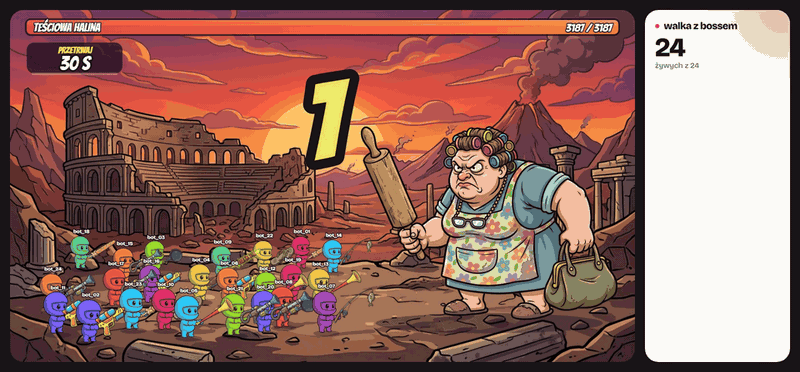

<table>
<tr><td>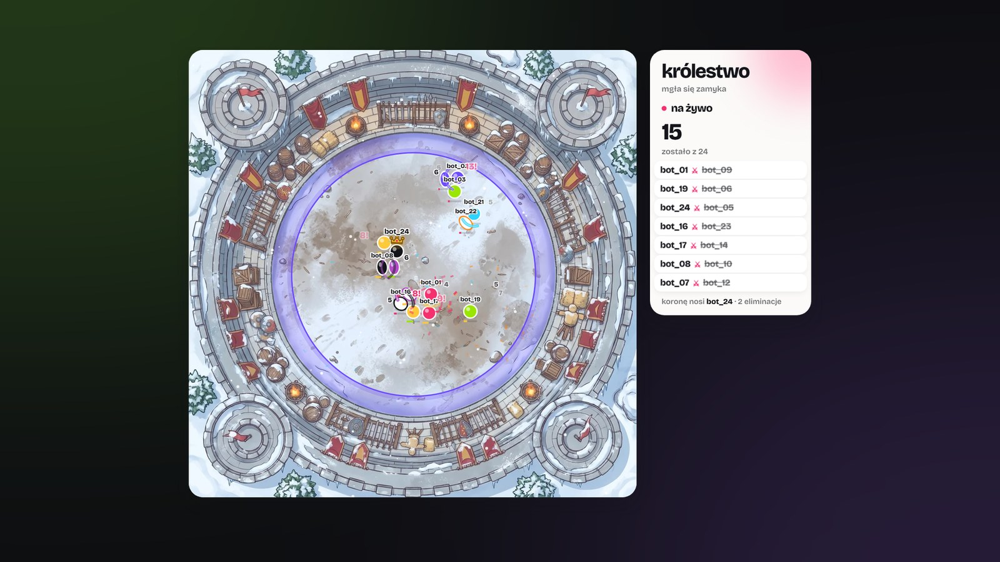 <b>Królestwo</b></td><td>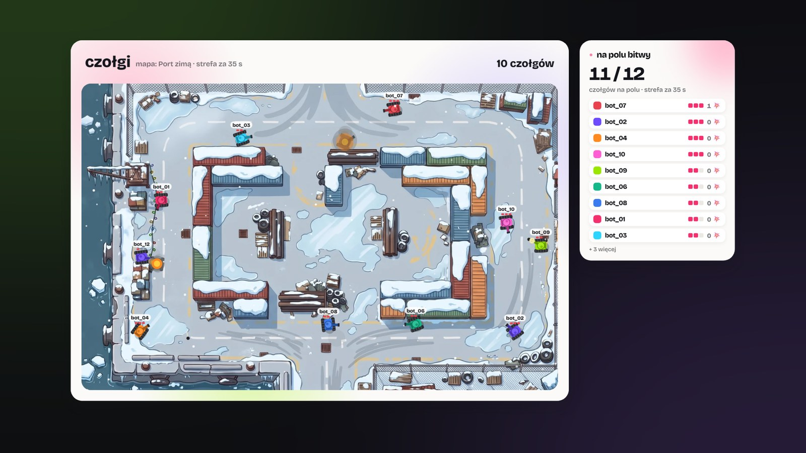 <b>Czołgi</b></td></tr>
<tr><td>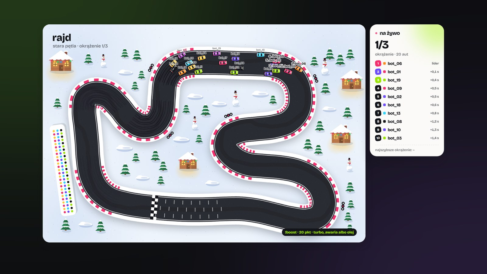 <b>Rajd</b></td><td>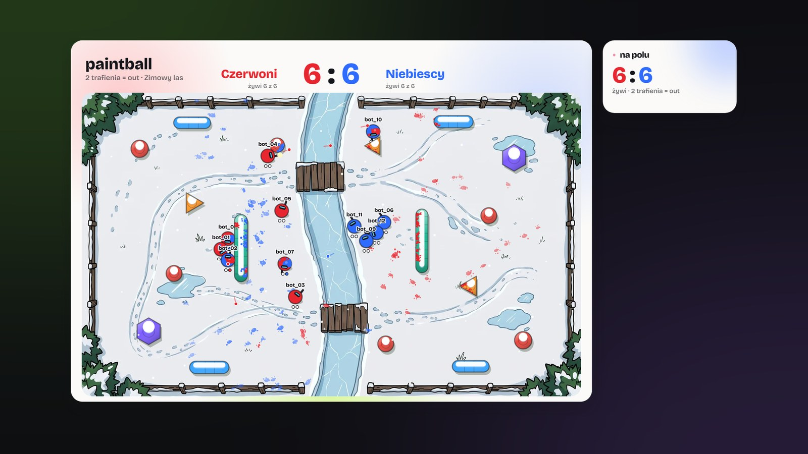 <b>Paintball</b></td></tr>
<tr><td>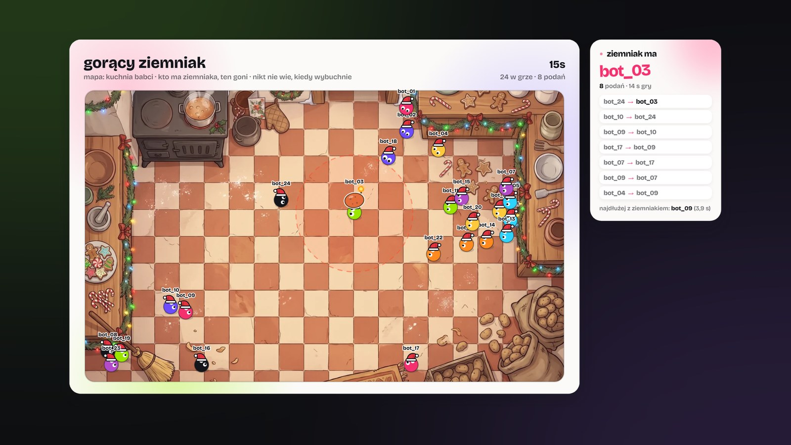 <b>Gorący ziemniak</b></td><td>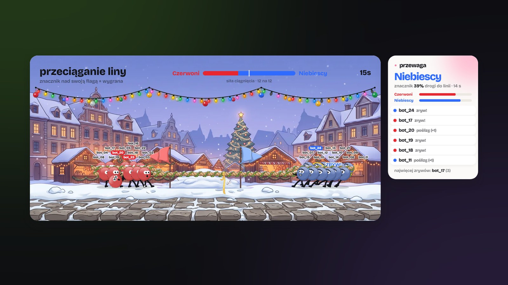 <b>Przeciąganie liny</b></td></tr>
</table>

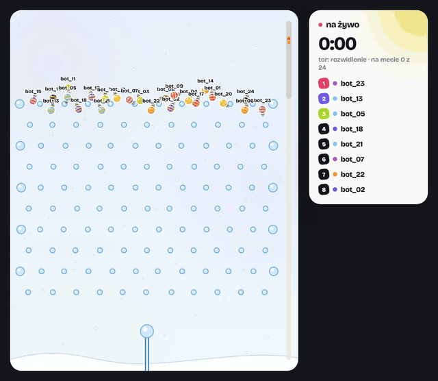

<b>Wyścig kulek</b> (<code>!wyscig</code>): każdy, kto wpisał <code>!gram</code>, dostaje kulkę, a wygrywa ta, która pierwsza dotrze na metę.

### Wszystkie 29 gier

Nagrody to domyślne kwoty w punktach. Większość z nich zmienisz w panelu.

**Wyścigi i bitwy.** Widzowie zapisują się przez `!gram` i oglądają swoją postać na ekranie.

| Gra | Komenda | Na czym polega | Nagrody |
|---|---|---|---|
| Wyścig kulek | `!wyscig` | Kulki widzów zjeżdżają po losowym torze. | 100 / 50 / 25 |
| Królestwo | `!krolestwo` | Battle royale kulek w kurczącej się strefie. | 150 / 60 / 30, +10 za eliminację |
| Rajd | `!rajd` | Samochodziki, trzy okrążenia na jednym z pięciu torów. Kierowcy mogą wpisać `!boost` (20 pkt): turbo, awaria silnika albo plama oleju. | 120 / 60 / 30 |
| Bieg z przeszkodami | `!bieg` | Młoty, belki, tłoki i bramy na 6 mapach, każdy bieg losuje inną. | 120 / 60 / 30 |
| Sumo | `!sumo` | Wypychanie z kurczącego się ringu. | 150 / 60 / 30, +10 za eliminację |
| Podłoga to lawa | `!lawa` | Pola gasną jedno po drugim pod kulkami. | 150 / 60 / 30, +10 za wypalone pole |
| Zielone / czerwone | `!swiatlo` | Biegniesz na zielonym, na czerwonym stoisz. | 140 / 60 / 30 |
| Walka z bossem | `!boss` | Każdy dostaje absurdalną broń i bije się ze smokiem, zombie albo teściową. Kto przetrwa 30 s, wygrywa. | 120 / 60 / 30, +40 za przeżycie |
| Czołgi | `!czolgi` | Każdy na każdego na 4 mapach. Czołgi same jeżdżą i strzelają, 3 trafienia i po czołgu, a strefa się zwęża. | 150 / 60 / 30, +10 za zestrzelenie |
| Meteory | `!meteory` | Wyspa w kosmosie się kurczy, z nieba spadają meteory. Wygrywa ostatni na wyspie. | 200 |
| Zombie | `!zombie` | W nocnym miasteczku pacjent zero zaraża innych dotykiem, a szczepionki dają 6 s odporności. Trzeba dotrwać 35 s jako człowiek. | Ludzie 100, zarażeni 15, zombie +10 za ugryzienie |
| Kaczki | `!kaczki` | Gonitwa za kaczkami na jednej z 4 map. Kto trzyma kaczkę, zbiera sekundy, a wygrywa pierwszy z 30 s. | 150 i coraz mniej do 10, ostatni −50 |
| Krzesła | `!krzesla` | Muzyka staje, a kto nie zdąży usiąść, odpada. | 150 / 60 / 30 |
| Spadochron | `!spadochron` | Skok nad wyspę z tarczą, a wiatr znosi każdego inaczej. | Środek +500, pierścienie +200 / +100, woda −200 |
| Skoki narciarskie | `!skoki` | Każdy oddaje jeden skok, a odległość zależy od formy i wiatru. | 150 / 60 / 30, +100 za rekord skoczni |
| Zjazd na sankach | `!sanki` | Kręta rynna ze szczytu w dół: kamienie, bałwany, skocznie i lód. | 150 / 60 / 30 |
| Mikołaj gubi prezenty | `!mikolaj` | Wyścig do paczek wyrzucanych z worka: konsola +300, ale też rózga −100. | Suma otwartych paczek |
| Gorący ziemniak | `!ziemniak` | Ziemniak z lontem przechodzi z rąk do rąk, aż wybuchnie. | Trzymający −150, w promieniu wybuchu −50, reszta +50 |

**Gry drużynowe.** Bot dzieli zapisanych na dwie losowe drużyny.

| Gra | Komenda | Na czym polega | Nagrody |
|---|---|---|---|
| Siatkówka | `!siatkowka` | Siatkówka plażowa, mecz do 3 punktów. | Wygrani 50, przegrani 10, +10 za punkt |
| Paintball | `!paintball` | Czerwoni kontra Niebiescy na polu z rzeką i osłonami, 2 trafienia = out. | Wygrani 50, przegrani 10, +10 za eliminację |
| Bitwa na śnieżki | `!sniezki` | Bieganie od osłony do osłony, które kruszą się od trafień, na 4 mapach. Raz na bitwę sanie Mikołaja zrzucają prezent, który przyspiesza rzuty. | Wygrani 50, przegrani 10, +10 za każdego bałwana |
| Przeciąganie liny | `!lina` | Drużyny ciągną linę nad błotem. | Wygrani +100, przegrani −50 i kąpiel w błocie |

**Zagadki dla czatu.** Cały czat zgaduje razem, każdy ma jedną próbę na 5 s.

| Gra | Komenda | Na czym polega | Nagrody |
|---|---|---|---|
| Sejf | `!sejf` | Czat łamie 4-cyfrowy kod z podpowiedziami jak w Wordle. Skarbiec startuje od 100 i rośnie z każdą próbą, po 3 min włącza się alarm. | Cały skarbiec, +10 dla reszty zgadujących |
| Hasło | `!haslo` | Wordle na czacie: 4-literowe polskie słowo. | Pula 250, każda nietrafiona próba zabiera 5% |

**Gry o punkty.** Widzowie stawiają własne punkty.

| Gra | Komenda | Na czym polega | Wypłata |
|---|---|---|---|
| Ruletka | `!ruletka` | 30 s na zakłady `!bet <kolor> <ile>`, potem losowanie na ekranie. | Zależnie od koloru |
| Wyścig koni | `!konie` | 45 s na zakład na jednego z 4 koni, każdy ma 25% szans. | ×3,5 |
| Drzwi | `!drzwi` | 4 etapy: 2, 3, 4 i 5 drzwi, tylko jedne prowadzą dalej. Między etapami `!stoj` odbiera wygraną. | ×1,6 / ×4,8 / ×19 / ×95 |
| Licytacja skrzyni | `!licytacja` | Losuje się jedna z trzech skrzynek. Kto utrzyma najwyższą ofertę przez 10 s, płaci i ją otwiera. | Zawartość skrzyni |
| Rosyjska ruletka | `!rosyjskaruletka` | Gracze płacą wpisowe, a rewolwer krąży. | Pula dla ocalałych |

Moderatorzy mogą też wylosować grę (`!gra`), wystartować ją bez czekania na koniec zapisów albo ją odwołać, a wtedy stawki i wpisowe wracają do graczy. Każdą grę wyłączysz w panelu.

### 22 motywy

Motyw wybierasz w panelu, a gry, które już masz w OBS, zmieniają wygląd od razu.

- **7 motywów kolorystycznych** zmienia tylko akcenty, czyli napisy, paski i plakietki: Onyx, Kick, Ocean, Fiolet, Cukierek, Złoto i Grafit.
- **13 pełnych motywów** zmienia karty, tła i dekoracje: Kosmos, Zima, Mocny róż, Glamour, Zielona mgła, Dyniowe pole, Upiorna noc, Karbon, Matcha, Neapolitańskie, Royal, Laguna i Wiśnia.
- **2 przezroczyste** pokazują stream pod spodem: Szkło (ciemne półprzezroczyste karty) i Bez tła (same napisy i plansze).

## Widżety

Każdy widżet ma własny link do OBS i podgląd w panelu, a większość ma kilka wyglądów.

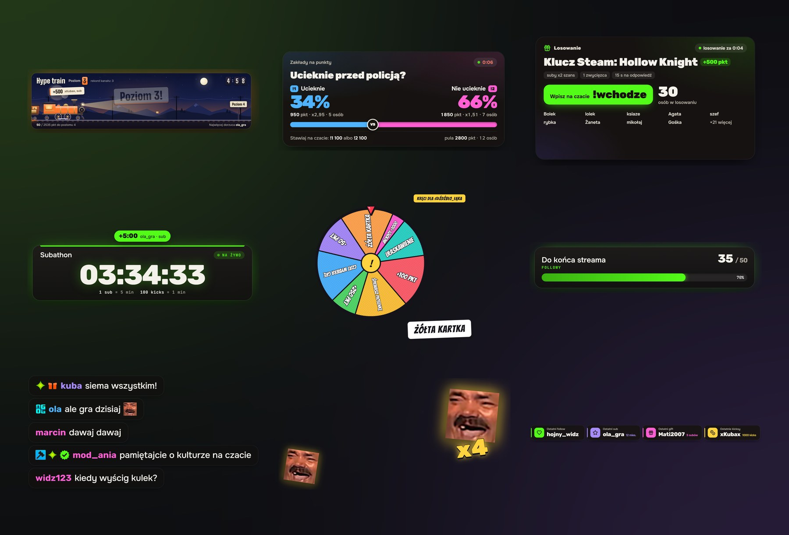

| Widżet | Co robi | Wyglądy |
|---|---|---|
| Czat na ekranie | Wiadomości z odznakami i emotkami. | 8: Karty, Sam tekst, Bąbelki, Panel, Transmisja, Linia, Telefon, Pixel |
| Latające emotki | Emotki 7TV na ekranie, kilka takich samych robi kombo. | |
| Ludziki z czatu | Każdy, kto napisze, dostaje swojego ludzika. | |
| Pasek celu | Followy, suby, kicksy albo wiadomości, z licznikiem, ile zostało. | 11 |
| Subathon | Każdy sub, gift i kicksy dokładają czasu. | 6 kolorów |
| Hype train | Seria subów i kicksów rozpędza pociąg, poziom po poziomie. | 6 kolorów |
| Ostatni wspierający | Ostatni follow, sub, gift i kicksy. | 4 |
| Licznik widzów | Ilu ogląda teraz i szczyt streama. | 3 |
| Ankieta i zakłady | Widzowie obstawiają punktami wynik (`!ankieta`). | |
| Koło fortuny | Do 5 kół, każde z własną komendą i polami o różnej wadze. Może dopisać albo zabrać widzowi punkty (`!kolo`). | |
| Losowanie | Zwycięzca losowany na ekranie. | 3 animacje: Skrzynka, Bęben, Mieszanie liter |
| TTS | Bot czyta na głos wiadomość z czatu (`!tts`), z kosztem w punktach, odstępem i filtrami. | |

Do tego dźwięki: widz kupuje dźwięk za punkty, a ten gra na streamie bez obrazu.

## Alerty

Follow, sub, suby w prezencie, raid i kicksy mają własne alerty. Wygląd zmieniasz jednym kliknięciem, a podgląd w panelu od razu go pokazuje.

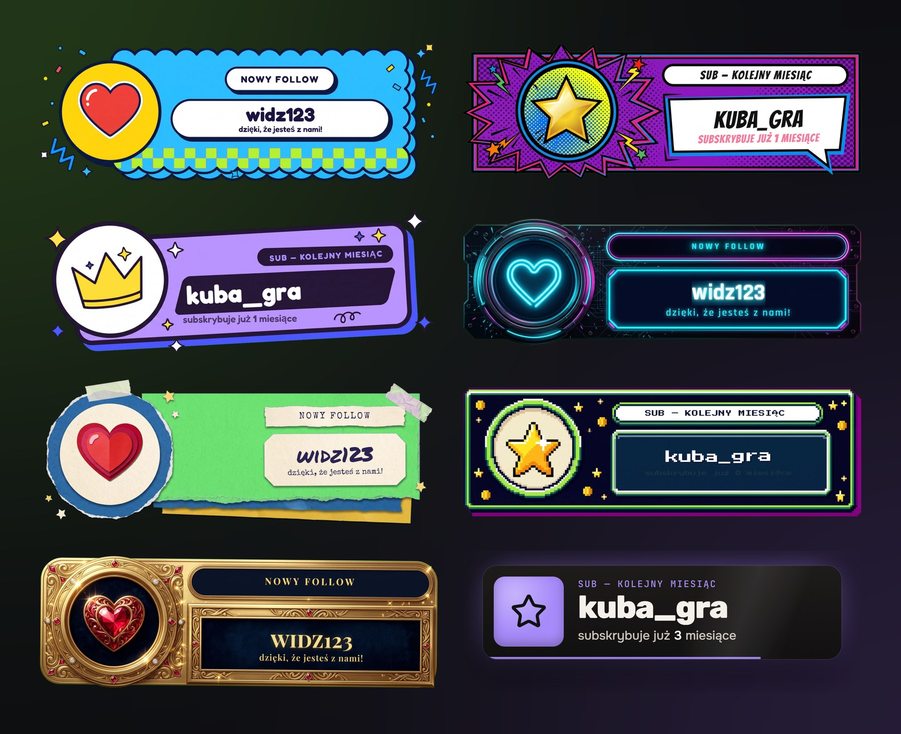

**12 wyglądów:** Klasyczny, Naklejka, Dopamina, Wycinanka, Pixel 8-bit, Neon, Komiks, Złoto, Minimal, Jasny, Linia i Karta (kolekcjonerska karta z avatarem widza, rzadkością i statystykami).

Każdy rodzaj alertu może mieć:

- własny wygląd i dźwięk,
- własny GIF z Giphy nad tekstem, obok tekstu albo z tekstem na GIF-ie,
- własny tekst z nickiem widza,
- ramkę w jednym kolorze albo z gradientem.

## Punkty i nagrody

Punkty to waluta Twojego kanału. Nie da się ich kupić ani wypłacić, a każdy kanał ma osobne konta.

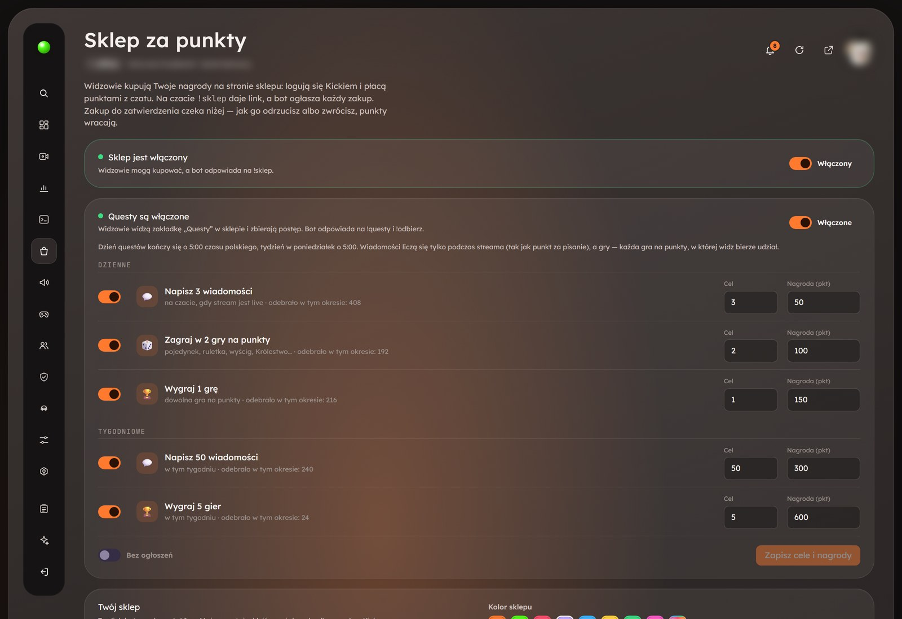

**Zdobywanie**

- **Oglądanie:** 1 punkt za minutę, sub 2 (obie wartości zmienisz). Kick nie podaje listy widzów, więc „ogląda” ten, kto pisze na czacie w trakcie live, a przerwa w pisaniu liczy się najwyżej za 10 minut.
- **Pisanie:** punkt za każdą wiadomość w trakcie live. Komendy się nie liczą, a jedna osoba dostaje punkty najwyżej raz na 5 s, więc spam nic nie daje.
- **Gry:** nagrody z [gier](#wszystkie-29-gier) na ekranie.
- **Wyścig słowny:** co jakiś czas bot rzuca słowo albo proste działanie, a pierwsza dobra odpowiedź dostaje 50 punktów.
- **Questy:** dzienne i tygodniowe zadania: napisz wiadomości, zagraj, wygraj. `!questy` pokazuje postęp, a `!odbierz` wypłaca nagrodę. Dzień kończy się o 5:00 czasu polskiego, a tydzień w poniedziałek o 5:00.
- **Osiągnięcia:** 17 wbudowanych osiągnięć z poziomami brąz, srebro i złoto (+100 / +500 / +2000 pkt) i do 50 własnych. `!odznaki` pokazuje zdobyte odznaki.

**Wydawanie**

- **Sklep z nagrodami:** `!sklep` podaje link do sklepu kanału. Widzowie logują się Kickiem albo Twitchem i wydają punkty na nagrody ustawione przez Ciebie. Zakupy do zatwierdzenia czekają w panelu, a odrzucone wracają na konto.
- **Pojedynki:** `!duel @nick <ile>`, a drugi widz ma 60 s na akceptację. `!matma` to pojedynek w liczeniu w pamięci.
- **Blackjack:** `!bj <ile>` z krupierem na czacie, do tego `!hit`, `!stand` i `!double`. Wygrana ×2, blackjack ×2,5.
- **Zakłady:** moderator otwiera zakłady z 2–5 opcjami, a widzowie stawiają punkty (`!1 100`, `!2 all`). Wygrani dostają stawkę i część przegranej puli według wkładu.
- **Gry o punkty:** ruletka, wyścig koni, drzwi, licytacja skrzyni i rosyjska ruletka.

## Panel streamera

Logujesz się kontem z Kicka albo Twitcha i masz cały kanał w jednym miejscu: jak poszedł stream, kto był najaktywniejszy i ustawienia każdej funkcji.

<table>
<tr><td>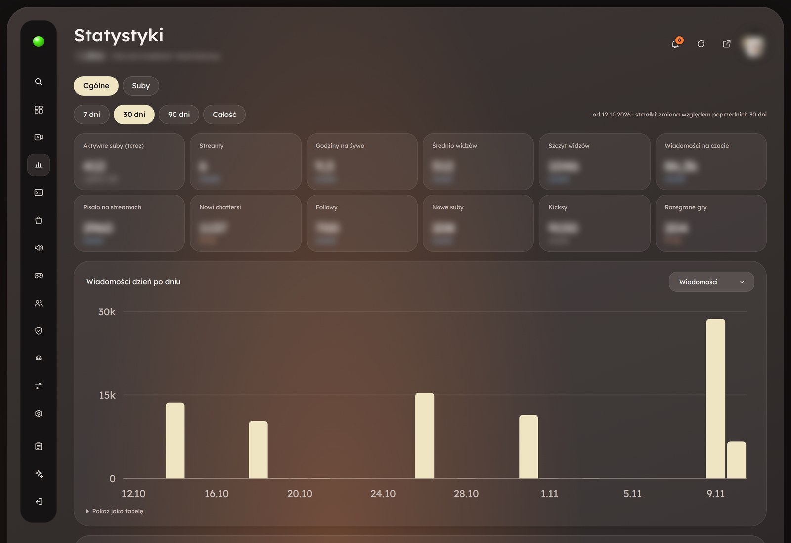 <b>Statystyki</b></td><td>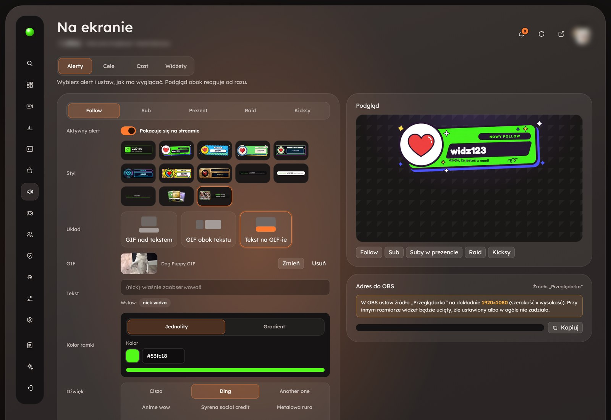 <b>Alerty i widżety</b></td></tr>
<tr><td>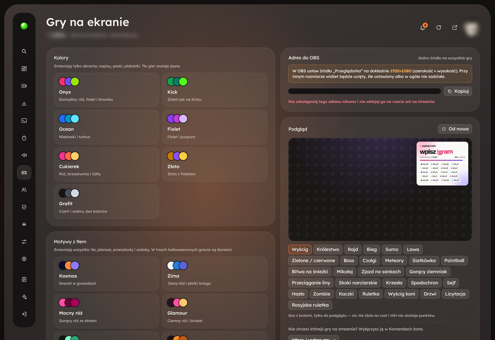 <b>Gry i motywy</b></td><td>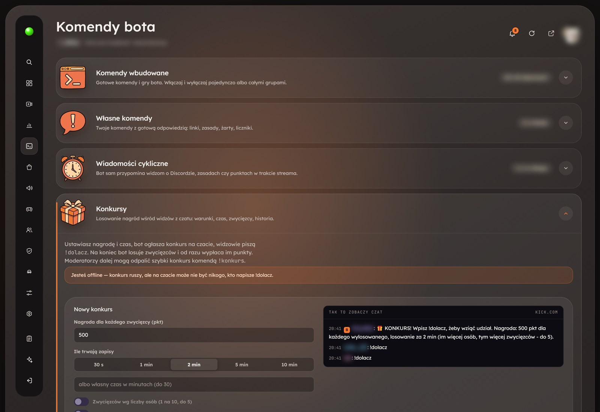 <b>Komendy i konkursy</b></td></tr>
</table>

Dane kanału na zrzutach panelu są rozmyte.

| Zakładka | Co w niej jest |
|---|---|
| Przegląd | Ostatnie 30 dni w skrócie: nowe followy, aktywne suby, kicksy, nowi chattersi, wykres aktywności i najlepsi widzowie. |
| Statystyki | 12 wskaźników za 7, 30 albo 90 dni lub całość, ze zmianą względem poprzedniego okresu, i wykres dzień po dniu: aktywne suby, streamy, godziny na żywo, średnio i szczyt widzów, wiadomości, piszący, nowi chattersi, followy, nowe suby, kicksy i rozegrane gry. |
| Historia streamów | Każdy stream zapisany z czasem, szczytem i średnią widzów, wiadomościami, piszącymi, nowymi followami, subami i kicksami. |
| Widzowie | Konto punktów każdego, kto pisał na czacie. Sortowanie po punktach, wiadomościach albo ostatniej aktywności i ręczna zmiana punktów. |
| Komendy bota | Każdą wbudowaną komendę włączasz albo wyłączasz, zawężasz do subów i ustawiasz jej odstęp. Do tego własne komendy, wiadomości cykliczne i konkursy. |
| Na ekranie | Alerty, cele, czat i widżety, każdy z podglądem na żywo i linkiem do OBS z dokładnym rozmiarem źródła. |
| Gry na ekranie | Motywy, podgląd, włączanie gier i kwoty nagród. |
| Sklep za punkty | Nagrody, zatwierdzanie zakupów, questy i ich cele. |
| Punkty i gry | Ile punktów wpada i za co. |
| Moderacja, Osiągnięcia, Discord | Opisane wyżej i niżej. |
| Co nowego | Lista wszystkich zmian w bocie, od najnowszych. |

## Moderacja

Automoderacja jest domyślnie wyłączona, a każdą ochronę włączasz osobno. Ciebie i Twoich moderatorów bot nigdy nie sprawdza.

- **Ochrony czatu:** CAPS, za dużo emotek, linki (z listą dozwolonych stron) i za dużo symboli. Emotki z Kicka i 7TV, linki i @nicki nie liczą się do CAPS ani symboli.
- **Zakazane słowa:** do 500 wpisów, jako fragment (łapie też odmiany) albo całe słowo. Wielkość liter, polskie znaki, cyfry zamiast liter (`sp4m`), rozciąganie (`spaaam`) i kropki albo spacje między literami (`s.p.a.m`) nie pomogą. Gotową listę polskich wulgaryzmów dodasz jednym kliknięciem.
- **Kara za powtarzanie:** bez kary, timeout albo ban.
- **Wyjątki:** słowa, których filtr nigdy nie rusza.
- **Sprawdzanie wiadomości:** wpisujesz, co mógłby napisać widz, i od razu widzisz wynik, bez wysyłania na czat.
- **Log** usuniętych wiadomości.

## Discord

Do kanału podłączasz jeden serwer Discord.

- **Powiadomienia o streamie:** gdy startujesz, bot wysyła zaprojektowaną przez Ciebie wiadomość z tytułem, kategorią i linkiem, wybranym oznaczeniem i kolorem oraz przyciskiem „Oglądaj na Kicku”.
- **Rola suba:** widz łączy konto Kick przez `!polacz KOD` i rola suba przychodzi sama, a znika po wygaśnięciu suba.
- **Dodatkowe kanały:** bot napisze też o streamach innych streamerów z Kicka, np. znajomego, nawet jeśli nie mają OnyxBota.
- **Własne komendy:** komendy slash z Twoją odpowiedzią, np. `/regulamin`.

## Komendy

**Dla widzów**

| Komenda | Co robi |
|---|---|
| `!gram` | Zapis do gry na ekranie w trakcie zapisów. |
| `!punkty [@nick]` | Punkty i miejsce w rankingu, swoje albo kogoś z czatu. |
| `!top` | Pięć osób z największą liczbą punktów. |
| `!komendy` | Lista komend włączonych na kanale. |
| `!sklep` | Link do sklepu z nagrodami. |
| `!questy` / `!odbierz` | Postęp questów / odbiór ukończonych. |
| `!odznaki` / `!odznaka <nazwa>` | Zdobyte odznaki / za co jest osiągnięcie. |
| `!duel @nick <ile>` / `!matma @nick <ile>` | Pojedynek / pojedynek matematyczny o punkty. |
| `!akceptuj` / `!odrzuc` | Przyjęcie / odrzucenie pojedynku. |
| `!bj <ile>`, `!hit`, `!stand`, `!double` | Blackjack z krupierem. |
| `!tts <wiadomość>` | Wiadomość czytana na głos na streamie. |
| `!polacz KOD` | Połączenie konta Kick z Discordem. |

**Dla Ciebie i moderatorów**

| Komenda | Co robi |
|---|---|
| `!wyscig`, `!boss`, `!czolgi` i inne | Otwiera grę na ekranie (wszystkie 29 są [wyżej](#wszystkie-29-gier)). |
| `!gra` | Losuje jedną z włączonych gier. |
| `!ankieta` | Zakłady na ekranie: `!ankieta 120 Ucieknie? / Tak / Nie`, potem `!ankieta wygrywa 1`. |
| `!konkurs <ile> [sekundy]` | Konkurs: widzowie piszą `!dolacz`, a bot losuje zwycięzców. |
| `!kolo`, `!kolo @nick`, `!kolo losuj` | Koło fortuny, dla widza albo dla losowej osoby z czatu. |
| `!dajpunkty @nick <ile>` / `!zabierzpunkty` | Ręczne dodawanie i zabieranie punktów. |
| `!resetpunkty` | Zeruje punkty wszystkim na kanale. Tylko streamer, z dwoma potwierdzeniami. |

## Start w trzech krokach

1. **Napisz na [Discordzie](https://discord.gg/ss7j3EvKMQ)** i podaj nick z Kicka albo Twitcha, a dodamy bota na Twój kanał.
2. **Dodaj linki do OBS:** jedno źródło przeglądarki na gry, osobne na alerty i widżety. Linki i dokładne rozmiary skopiujesz z panelu.
3. **Wpisz `!wyscig`.** Czat zapisuje się przez `!gram`, a bot zajmuje się resztą.

## Pytania

**Czy muszę coś instalować?**
Nie. Bot działa na serwerze, a gry i alerty dodajesz do OBS jako źródło przeglądarki.

**Czy widzowie muszą się gdzieś logować?**
Nie. Wystarczy, że piszą na czacie Twojego kanału. Logowanie Kickiem albo Twitchem jest potrzebne tylko w sklepie z nagrodami.

**Czy punkty mają wartość pieniężną?**
Nie. To waluta Twojego kanału. Nie da się ich kupić ani wypłacić.

**Co z danymi widzów?**
Bot przechowuje nick, punkty i czas oglądania na Twoim kanale, a ze streamerem podpisujemy umowę powierzenia danych.

## Kontakt

[kontakt@onyxbot.live](mailto:kontakt@onyxbot.live) · [Discord](https://discord.gg/ss7j3EvKMQ) · [onyxbot.live](https://onyxbot.live)
